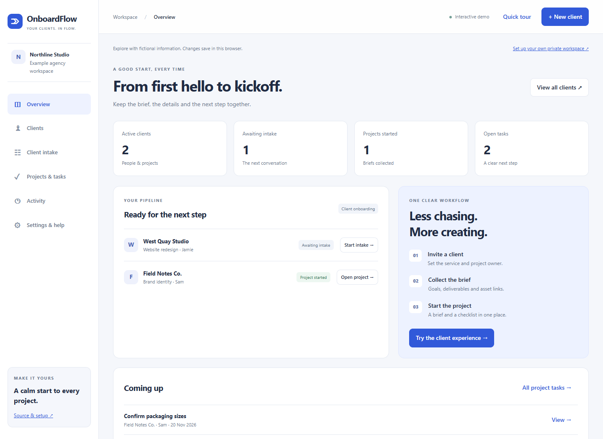
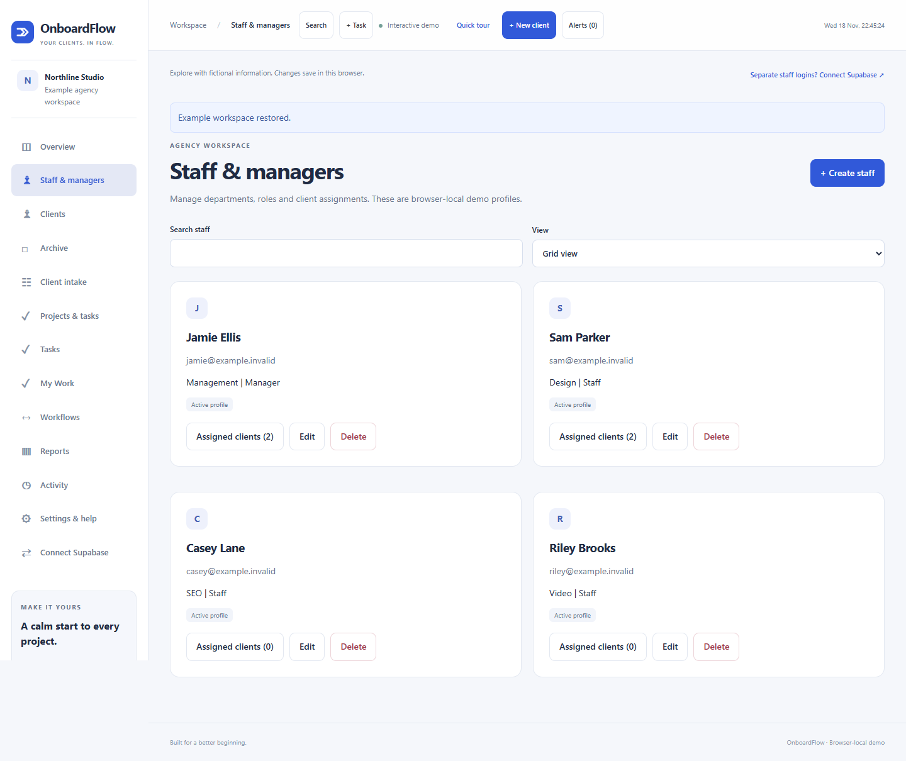

# OnboardFlow

A client onboarding workspace for agencies: collect a clear brief, organise the handoff and keep project tasks moving.

[Try the interactive demo](https://onboardflow-workflow-demo.ranakaharian1.workers.dev/) · [Portfolio](https://ranova.vercel.app/technical-projects)



## What you can try

- **Staff & managers:** fictional staff profiles, departments, demo roles, active/inactive status, grid/list views, search, editing/deletion and assigned-client lists.
- **Clients:** add/edit clients, choose an industry category or create your own, filter by category/manager, assign multiple staff, archive and restore.
- **Client workspace:** contact/website/social/Drive links; communication notes, assets, dated local visibility observations, vouchers, branches, campaigns, calendar entries, tasks and activity history. Email/WhatsApp buttons compose in your own app; they do not send automatically.
- **Client intake:** a three-step questionnaire and saved draft. Submitted answers become a project brief and kickoff tasks; revisions preserve the task list.
- **Tasks:** Dashboard, Board, List, Charts, Calendar, Timeline and Tickets, backed by the same records. Multiple assignees, priority, status, start/due dates, search/filters, comments and in-app date reminders.
- **My Work:** staff/month filters, design/general, SEO and video views, daily status notes, demo manager checks, monthly calendar, a browser timer and labelled manual hours.
- **Workflows:** ordered staff handoffs followed by a demo manager approval. Stuck and overdue work remains visible.
- **Reports:** monthly performance counts, hours, daily audit, attendance entries and staff logs, with CSV and Print / PDF. Figures come from saved records, not invented performance scores.
- **Overview & utilities:** task status counts, upcoming work, workspace search, task alerts, actual browser clock and client archive with confirmed permanent deletion.
- **Settings & help:** branding, guided tour, JSON backup/import/reset, plus a [Supabase connection guide](docs/CONNECT-SUPABASE.md) and empty configuration download.

[Read the agency demo guide](docs/DEMO-AGENCY.md).



The public demo uses fictional data and browser storage. It has no public signup, verified staff sessions, shared cloud sync, real file uploads, email delivery or external AI calls. Profiles and approval buttons demonstrate the workflow; they do not enforce account permissions. Connect and verify a private installation for real staff accounts. Do not enter real client information. Demo JSON backups preserve browser records, not cloud files or credentials.

## How to use

1. Open **Quick tour**, or explore the sample pipeline.
2. Choose **New client**, add fictional details and save. Open that client's intake.
3. Complete **The project**, then **The details**. Check the review and submit.
4. Open **Projects & tasks**. Review the brief, add a task, set its owner/date and mark work complete.
5. Download or print the brief. **Activity** exports a CSV report.
6. **Settings & help → Download backup** saves all demo records. **Import backup** replaces this browser workspace after confirmation. Export first if you want to keep its current records.
7. Archive a client to retain the record outside the active pipeline. Restore it from the archived filter.

Use **Staff & managers**, **Tasks**, **My Work**, **Workflows** and **Reports** to try the expanded agency tools. Client categories and assigned teams are in each client’s edit form. **Client workspace** opens that client’s notes, links and related records.

## Run the demo locally

From the extracted repository, with Python installed:

```powershell
python -m http.server 8080 --directory demo
```

Open **http://localhost:8080**. No keys or account needed.

## Install your own workspace

The full application uses TypeScript, React, Next.js and Supabase PostgreSQL, Auth and private Storage. It includes agency login, branding, questionnaire/checklist templates, client portals, private uploads, projects, tasks, staff profiles, workflows and reports. Staff profiles are records; they are not separate staff login accounts. Optional AI and email require provider configuration.

1. Download or fork this repository. Use Node.js 22 or newer.
2. Create a fresh Supabase project in your own account.
3. Copy `.env.example` to `.env.local`. Add your Supabase project URL, public key, private service-role key and app URL. Keep this file private.
4. In Supabase's SQL editor, apply the files in `supabase/migrations` in order: `001`, `002`, `003`, `004`, `005`, `006`, `20261005214234_persistent_workspace.sql`, `20261006193735_template_configuration.sql`.
5. Set Supabase Auth's site and redirect URLs to your app domain. Configure a verified email sender before inviting real users. Keep `uploads` and `contracts` buckets private.
6. Run:

```powershell
npm ci
npm run build
npm start
```

Open **http://localhost:3000**. Create an agency account, configure a template, create a client and copy their private onboarding link. Anyone holding that client link can access its allowed portal; share it privately.

Deploy the full app to a **Node.js host**, such as Vercel, and set its environment variables there. Static Cloudflare hosting alone cannot run the full Next.js backend. Follow [setup and verification notes](README-FIRST.md) for the remaining service checks.

## Publish your own public demo on Cloudflare

For the browser-only demo, connect your fork in Cloudflare's static-site deployment flow. Use `demo` as the asset/output directory; no build command or backend keys are required. Alternatively, upload the contents of `demo` through the static-site upload flow.

For an API-uploaded Worker bundle:

```powershell
node scripts/build-demo.mjs
```

This generates `dist-demo/worker.mjs`, a self-contained Worker with the public demo assets and response security headers. Use your own Cloudflare account's deployment tooling to upload it as an ES module. No Supabase credentials belong in this demo.

## Backups, ownership and limits

Fork creates your own GitHub copy. Download ZIP gives you the source without Git history. Repository transfer is available to the owner under GitHub **Settings → General → Transfer ownership**. A source transfer does not transfer hosting, Supabase data, accounts, files or provider credentials; set those up separately.

Back up all application tables, including `agency_workspaces`, private upload/contract objects, and your Auth configuration. Test a restore into a separate project. The demo's JSON export is not a full-app disaster recovery backup.

Demo limits: 100 clients, 100 staff, 50 categories, 200 tasks per client plus 200 agency tasks, 200 records per client tool, 1,000 daily checks/time entries each, 200 recent activity entries and 2 MB JSON imports. Clearing browser storage removes demo records. The full app's provider delivery, separately authenticated staff accounts, recovery and AI accuracy require further validation before customer production use.

## Validation and languages

Demo browser checks cover the original intake/brief flow and the new staff/category/client records, seven task views, comments, daily review reset, timers/manual hours, workflow approvals, five report views, CSV/print, archive retention and complete backup restoration. All 13 screens were checked at 320, 390, 768 and 1440 pixels. Data checks cover legacy-record preservation, multiple assignees, unsafe-link stripping and backup limits. No live Supabase staff sign-in was tested.

Repeat the data checks with `node scripts/test-demo-data.cjs`. With Playwright and Chrome available, serve `demo` locally and run `node scripts/test-demo-agency.cjs http://localhost:8080`. Set `PLAYWRIGHT_MODULE` to an existing Playwright installation if it is not installed in this project. Browser test fixtures and screenshots are written to the operating system temporary folder.


TypeScript, JavaScript, HTML, CSS and SQL; React, Next.js, Supabase and Cloudflare Workers.
